# HCR Cells — how the images are processed

HCR Cells measures HCR RNA-FISH signal in the ASI and ASJ neurons of *C. elegans*
across a photobleaching series: the same worm imaged again and again (40 repeats).
For each cell of interest and each repeat it reports how bright each HCR channel
is and how many transcripts that corresponds to, so you can see how fast each
probe bleaches. A second mode handles **group experiments** -- one image per
worm, worms of several groups imaged on several days -- and writes the
transcripts per image and channel as a CSV ([section 16](#16-group-experiments)).

This page explains **what happens to the images, step by step**, in plain
language, with pictures of the real data after each step. No image-processing
background is assumed; technical terms are explained where they first appear and
in the [glossary](#glossary) at the end.

> The pictures on this page are made from the lab's unpublished data
> (`scripts/make_readme_figures.py` regenerates them). Treat them with the same
> care as the data itself.

---

## Contents

1. [The data](#1-the-data)
2. [The workflow at a glance](#2-the-workflow-at-a-glance)
3. [Finding the cells](#3-finding-the-cells-segmentation)
4. [Splitting cells that touch](#4-splitting-cells-that-touch)
5. [Choosing the cells of interest and the boxes around them](#5-choosing-the-cells-of-interest-and-the-boxes-around-them)
6. [Finding the HCR spots](#6-finding-the-hcr-spots)
7. [Measuring each cell](#7-measuring-each-cell)
8. [From signal to transcripts](#8-from-signal-to-transcripts)
9. [Following the cells across the 40 repeats](#9-following-the-cells-across-the-40-repeats)
10. [Bleaching curves and fits](#10-bleaching-curves-and-fits)
11. [Looking at the images](#11-looking-at-the-images)
12. [What you get (outputs)](#12-what-you-get-outputs)
13. [All settings](#13-all-settings)
14. [Limits — what the numbers cannot be trusted for](#14-limits)
15. [Running it](#15-running-it)
16. [Group experiments](#16-group-experiments)
17. [Glossary](#glossary)

---

## 1. The data

Each repeat ("timepoint") of a sample is one 3D image (a *z-stack*: 38 or 27 optical
sections stacked on top of each other) with four channels:

| Channel | What it shows | Used for |
|---|---|---|
| C0 | **daf-28** HCR | finding the cells (it fills the ASI/ASJ somata) and its own measurements |
| C1 | **ins-4** HCR | measurements |
| C2 | **ins-6** HCR | measurements, and choosing the cells of interest |
| C3 | DAPI (nuclei) | display; in group experiments also the drift and same-worm checks (section 16) |

Voxel size: 0.099 × 0.099 µm in x/y, 0.5 µm in z (a *voxel* is a 3D pixel). All
distances below are in µm and converted to voxels using these sizes, so the
settings mean the same thing whatever the image's resolution.

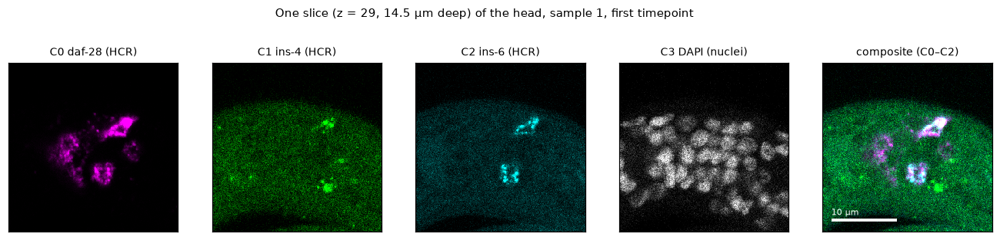

---

## 2. The workflow at a glance

What you do in the app — six steps, top to bottom:

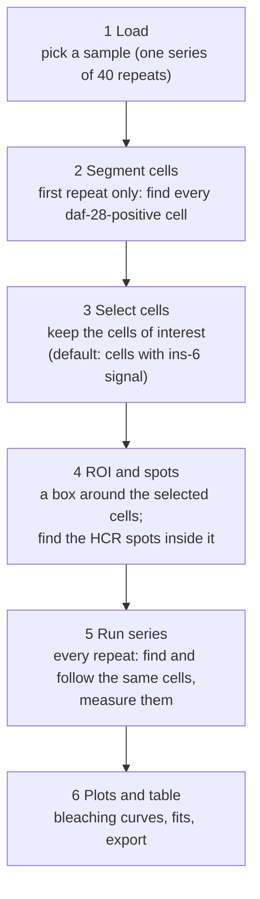

What happens to **each repeat** during *Run series* (the same steps the first
repeat goes through in steps 2–4):

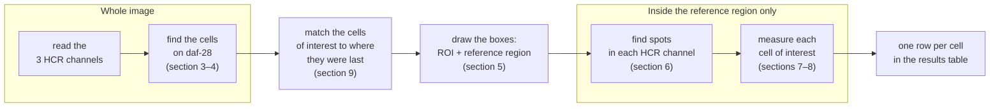

Finding the cells uses the whole image, because the worm can drift a little from
one repeat to the next. Everything after that only looks inside a box around the
cells of interest, which makes each repeat about twice as fast.

---

## 3. Finding the cells (segmentation)

*Segmentation* means deciding, for every voxel, whether it belongs to a cell and
to which one. The cells are found on the **daf-28** channel, which fills the
ASI/ASJ cell bodies with bright signal. Each panel below is the same slice after
one more step.

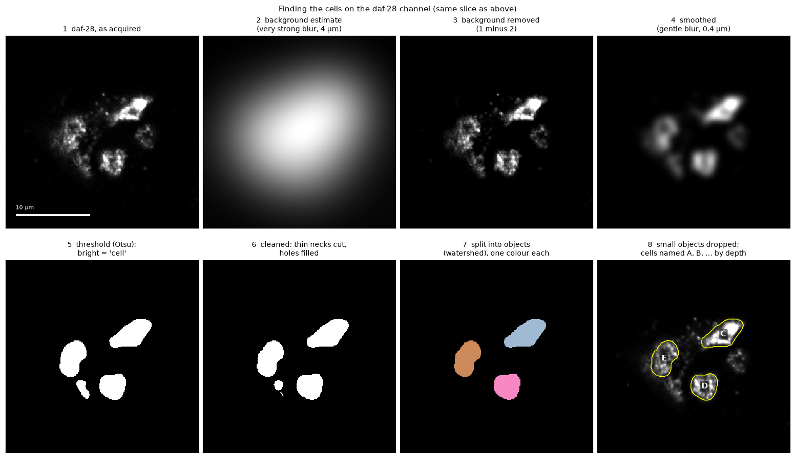

| Step | What it does | Why | Setting (default) |
|---|---|---|---|
| **1** | The daf-28 image as acquired. | | |
| **2** | A very strong blur (Gaussian, 4 µm wide) of the image. Blurring replaces every voxel by a weighted average of its neighbourhood; at 4 µm, cells are averaged away and only the slowly varying background glow is left. | The worm body glows faintly (autofluorescence). Without removing it, a single brightness cut would select the whole worm. | Background radius, 4 µm |
| **3** | Step 1 minus step 2 (negative values set to 0). | Removes the glow; cells now stand out from a dark surround. | |
| **4** | A gentle blur (0.4 µm). | Merges the granular HCR signal inside a cell into one smooth blob, so the next step makes one clean shape per cell instead of many specks. | Smoothing sigma, 0.4 µm |
| **5** | A brightness cut (*threshold*): voxels brighter than the cut are "cell", the rest "background". The cut is chosen automatically by **Otsu's method** (below). | Turns the image into a yes/no map (a *mask*). | Otsu (automatic) |
| **6** | *Opening* (0.5 µm) then hole filling. An opening shaves 0.5 µm off every edge and grows it back: anything thinner than about 1 µm — a thin bridge to a neighbouring blob, a speck — disappears and does not grow back. | Cuts thin necks between a cell and a neighbouring bright bit. | Opening radius, 0.5 µm |
| **7** | The mask is split into separate objects, one colour each (*watershed*, section 4). | Touching cells become separate cells. | Split cells closer than 3 µm |
| **8** | Objects smaller than 10 µm³ are dropped (a cell body is 20–60 µm³). The rest are named A, B, C, … from the shallowest to the deepest. | Removes debris; gives stable names. | Smallest cell, 10 µm³ |

**How Otsu's method picks the cut.** Plot how many voxels have each brightness:
there is a huge pile of dim background voxels and a long tail of bright cell
voxels. Otsu tries every possible cut and keeps the one that makes the two groups
each as uniform as possible. It needs no tuning, and it adapts to each image.

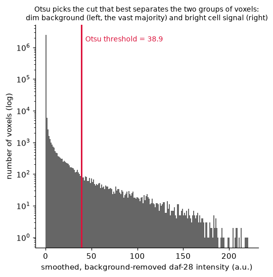

---

## 4. Splitting cells that touch

In sample 2, two cells touch in 3D, so after the brightness cut they are one
connected object. The **watershed** splits them:

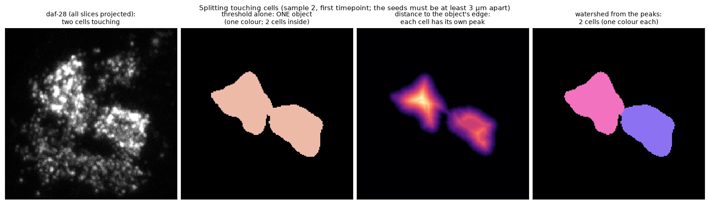

1. For every voxel of the object, compute its distance to the object's edge
   (panel 3). The centre of each cell is far from the edge; the narrow contact
   between two cells is close to it. So each cell has its own peak.
2. Every peak becomes a *seed*. Seeds closer than **3 µm** are treated as one
   (a cell is about 4 µm across, so two peaks closer than that are bumps of the
   same cell, not two cells).
3. Each seed grows outwards over the object, like water filling neighbouring
   basins; where two growing regions meet is the border between the cells
   (panel 4).

---

## 5. Choosing the cells of interest and the boxes around them

Not every daf-28-positive cell is an ASI/ASJ neuron. Each cell's **ins-6**
signal is measured (mean brightness inside the cell minus the background just
around it, section 7), and by default a cell below **3 a.u.** is left out. In
the app, the *Select cells* step shows this table; tick or untick **Include** to
change the choice.

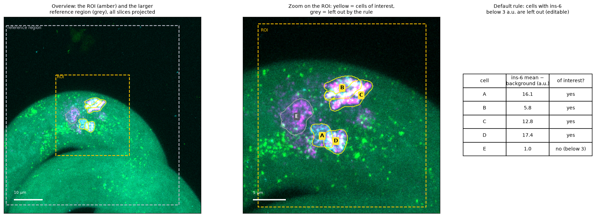

Two boxes are then drawn around the cells of interest:

- **ROI** (amber): the cells plus a margin of 8 µm in x/y and 3 µm in z.
- **Reference region** (grey): the same cells with a wider margin, 25 µm in x/y
  and 10 µm in z. Spot detection and everything after it happen in this box
  only. It is larger than the ROI on purpose: the conversion from signal to
  transcripts (section 8) needs *isolated* spots away from the cells, and the
  automatic spot threshold (section 6) needs enough background to judge the noise.

At every repeat both boxes are drawn again around where the cells are at that
repeat, so drift cannot move a cell out of its box.

**Naming the neurons.** The cells are lettered A, B, … by depth. Which one is
ASIL, ASIR, ASJL or ASJR is for you to say: the *Identity* column of the
*Select cells* table has a drop-down per cell, and each name can go to one cell
only (choosing a name another cell has takes it from that cell). The name then
appears on the cell's label (`A · ASIL`), in the results (`identity` column,
next to `cell`), in the plot legends, and it is saved with the session.

---

## 6. Finding the HCR spots

Each HCR transcript appears as a tiny bright dot (a *spot*, ~0.25 µm across).
Spots are found separately in each HCR channel, inside the reference region:

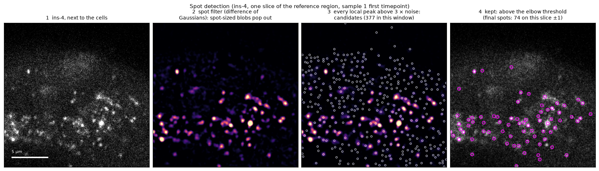

1. **The image** (panel 1).
2. **A spot filter** (panel 2). The *difference of Gaussians* subtracts a broad
   blur (3 × spot size) from a narrow one (spot size: 0.12 µm in x/y, 0.35 µm
   in z). What survives is structure about the size of a spot; smooth background
   and pixel-to-pixel noise both cancel out. Spots light up; everything else goes dark.
3. **Candidates** (panel 3): every local peak of the filtered image (brighter than
   everything within 0.2 µm in x/y and one slice, 0.5 µm, in z) that is above
   3 × the noise. The noise level is
   measured robustly with the *MAD* (median absolute deviation), which ignores the
   few real spots. This deliberately lets in many noise peaks.
4. **Final spots** (panel 4): the candidates above the **elbow threshold**:

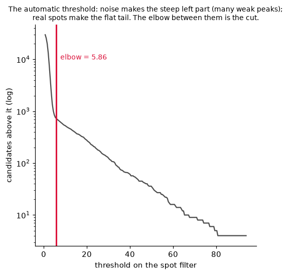

Count how many candidates remain above each possible threshold. Noise produces
very many weak peaks, so the count first falls steeply; real spots produce a long
flat tail. The **elbow** — the point of the curve farthest from the straight line
joining its two ends — separates them. This is the automatic threshold used by the
Big-FISH package; it adapts to each channel and each repeat with no hand-tuning
(and never goes below 5 × the noise).

---

## 7. Measuring each cell

For each cell of interest and each HCR channel:

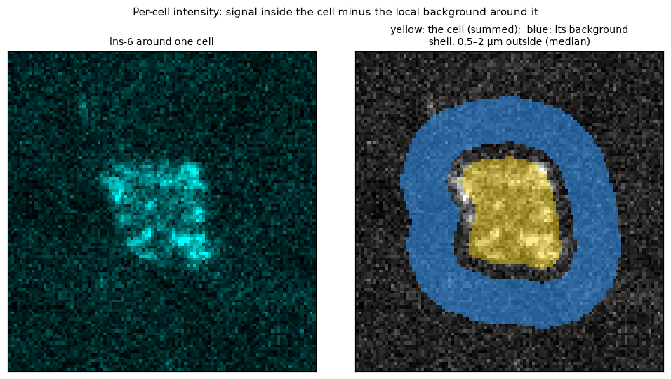

| Column (results table) | What it is |
|---|---|
| `<channel>_mean_au` | Mean brightness inside the cell (a.u. = arbitrary units, the camera's numbers). |
| `<channel>_background_au` | **Local background**: the median brightness in a thin *shell* 0.5–2 µm outside the cell (blue above). Each shell voxel belongs to its nearest cell, so two neighbouring cells never share background. The median ignores stray bright spots in the shell. |
| `<channel>_mean_bgsub_au` | Mean minus background: the cell's own signal. **This is the "intensity" in the plots.** |
| `<channel>_integrated_au` | The brightness summed over the whole cell. |
| `<channel>_integrated_bgsub_au` | The same minus the background of every voxel (the cell's total own signal). |
| `<channel>_spots` | Spots (section 6) whose centre lies inside the cell. |
| `<channel>_saturated_fraction` | Share of the cell's voxels at the camera's maximum (255): those voxels were brighter than the camera can record, so the true signal is higher. |
| `volume_um3`, `centroid_*_um` | Cell volume (µm³) and centre position (µm). |

---

## 8. From signal to transcripts

Inside the ASI/ASJ cell bodies the spots are so dense that they overlap; counting
separate dots then undercounts badly (a blob of ten overlapping spots counts as
one or two). Instead, the *total* signal is divided by the signal of a **single**
transcript:

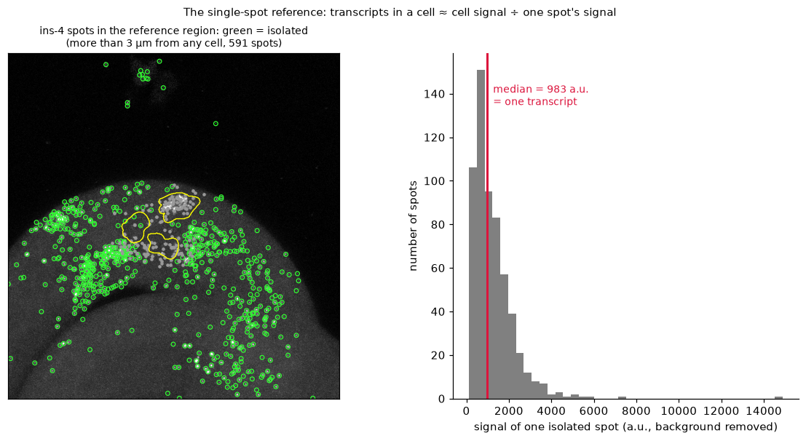

1. Take the spots in the reference region that are **more than 3 µm from any
   cell** — isolated spots, each very likely one transcript (green circles).
2. Sum each one's signal in a small box around it (±0.2 µm in x/y, ±0.5 µm in z),
   minus the local background.
3. The **median** of those sums is "one transcript's worth" of signal.
4. **Transcripts in a cell ≈ the cell's total background-corrected signal ÷ one
   transcript's signal** (column `<channel>_transcripts_est`; the single-spot
   signal and how many isolated spots it is the median of are in
   `<channel>_ref_spot_au` and `<channel>_n_ref_spots`).

This is the dense-region method of the Big-FISH package. It is recomputed at
every repeat, from that repeat's own isolated spots — see the limits in
[section 14](#14-limits): if isolated spots bleach at a different rate than the
cells, the estimate drifts over the series.

---

## 9. Following the cells across the 40 repeats

At every repeat the cells are found again on the whole image. Each cell of
interest is then matched to the cell nearest to where it was at the previous
repeat (the matching considers all cells together, so two cells cannot swap), if
it is within **3 µm**. A cell that is not found at one repeat keeps its last
position, so it can be picked up again at the next; it simply has no row for that
repeat.

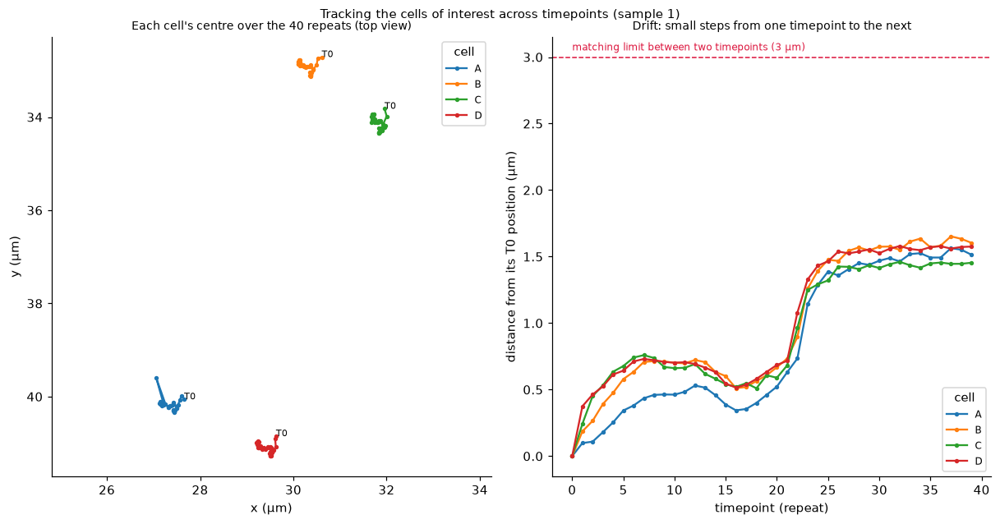

The cells move by well under 1 µm between repeats, far below the 3 µm limit. In
sample 1 all four cells jump together by ~0.7 µm around repeat 22 — the whole
worm (or the stage) shifted, which the tracking follows.

**Speed: parallel processing.** Finding the cells is the slow part (~25 s per
repeat). Several repeats are processed at the same time, each in its own process:

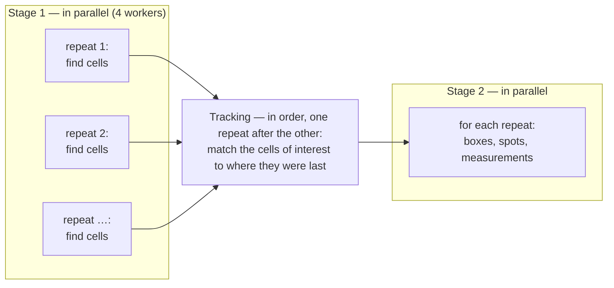

Only the matching has to happen in order, and it is fast. The results are
identical to processing one repeat after the other (checked), at about 15 s per
repeat instead of ~34 s on this computer.

---

## 10. Bleaching curves and fits

**Normalized or absolute.** By default each cell's values are divided by its own
value at the first repeat ("normalized to first T"), so every cell starts at 1.0
and the curves show the fraction of signal left. The plot window's *Intensity* and
*Spots* drop-downs switch to absolute values.

**Mean of cells.** The mean over the cells of interest, with ± SD (or SEM) as a
shaded band.

**Fit.** The mean curve can be fitted with two models:

| Model | Equation | Means |
|---|---|---|
| Linear decay | $y = a + b\,t$ | a constant loss per repeat ($b$) |
| Exponential decay to a plateau | $y = A\,e^{-t/\tau} + c$ | fast loss that slows down, levelling off at $c$; half-life $t_{1/2} = \ln 2 \cdot \tau$ repeats |

*Auto* keeps the model with the lower **AICc** (the Akaike information criterion,
corrected for small samples). AICc rewards a good fit but penalises extra
parameters, so the exponential (3 parameters) is chosen only when the curvature
is real, not just because more parameters always fit a little better. A
difference in AICc above ~2 is a clear preference; below 2 the two models fit
about equally well.

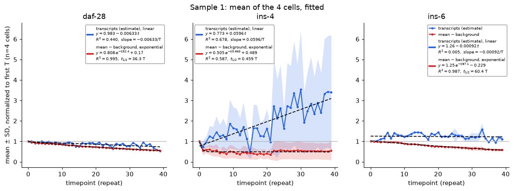

Fitted lines are black and dashed; each panel's equations sit in a box placed
where it covers the data least.

**Counting methods (optional plot).** *Plot → Counting methods* compares two ways
of counting the transcripts of a cell over the repeats: the number of spot
**peaks** in it (resolved spots, section 6) and the **Big-FISH estimate**
(section 8). Top: the mean of each over the cells (fits apply) -- normalized,
on one axis; absolute, the peaks on the left axis and the Big-FISH estimate on
the right (tens against hundreds or thousands per cell). Bottom: every cell at
every repeat, one against the other, coloured by repeat, with Spearman's rank
correlation. From the command line: `pixi run series -- --compare-counting`.

---

## 11. Looking at the images

The **Display** panel on the right sets what you see; the views in the middle show it.

**Channels.** One histogram with every channel in its own colour, with a
draggable min and max handle per channel; and per channel: show / hide, colour
table, opacity, min, max and gamma. They apply to every view, 2D and 3D, and
are saved with the session.

| Control | What it does |
|---|---|
| **min / max** | Brightness at or below *min* is black, at or above *max* full colour, in between a ramp. The default *min* is the elbow of the channel's brightness (the same automatic cut as the spot threshold, section 6), so the background is black; the default *max* is about the 99.95th percentile. |
| **gamma** | Bends the ramp between min and max without moving its ends (brightness *n* between 0 and 1 becomes *n*<sup>1/γ</sup>): γ above 1 lifts faint signal (0.25 becomes 0.5 at γ = 2) without saturating bright signal; γ below 1 darkens it. |
| **opacity** | Scales the whole channel evenly, brightest included. The channels are *added* together, so opacity sets how much each one contributes to the mix -- e.g. turn daf-28 down to see ins-6 in the same cells. |

**Views** (tabs under the image):

| View | What it shows |
|---|---|
| **Slice** | One z-section at a time (scroll through the stack), with the cell outlines, their labels (`A · ASIL` once named) and the spots of the chosen channel. |
| **MIP** | The *maximum-intensity projection*: for every pixel, each channel's brightest value through the whole stack, combined as above; the outlines of the projected cells and every spot. |
| **Ortho** | Three sections through one point -- XY, XZ and YZ; click any pane to move the point. Cells as see-through fills, spots near each plane. It starts on the cells. The XZ and YZ panes are thin strips: the stack is about 19 µm deep but 100 µm across (right-drag to zoom). |
| **3D** | The image as a volume, the cells as surfaces, the spots as small spheres (drag to rotate, scroll to zoom). |

**3D rendering** (the *3D* controls):

- **Additive (napari-style MIP)**, the default: for every pixel, each channel's
  brightest point along the line of sight, coloured as above, and the channels'
  colours added. Nothing hides anything; overlaps mix (magenta + cyan = white).
- **Composite (depth)**: see-through -- nearer voxels partly hide the ones
  behind them, so shapes and depth show.

*Image in 3D* turns the volume on or off; *Image opacity in 3D* is its overall
strength in additive mode (0.5 = as the channel controls set it) and how opaque
the brightest voxels are in composite mode (lower: see deeper); *Cell surface
opacity* sets the cells' surfaces (0 hides them). Below a channel's *min* the
volume is clear: raise a channel's min to remove its background haze in 3D.
The volume is built at half resolution in x / y, so it stays quick.

**Timepoints.** After *Run series*, the timepoint browser at the top of the
Display panel shows any repeat with its own cells and spots (cells not followed
at that repeat are grey). With *Auto contrast per timepoint* off (the default)
every repeat keeps the same min / max, so bleaching shows as dimming.

**Loading.** The slice you look at is read first and shown at once; the rest
load in the background ("All slices loaded" in the log), and MIP, Ortho and 3D
fill in from them.

**Plots and the results table** open in their own windows, only when you press
*Open plot window* or *Open results table* (step 6): after a run they are filled
but not opened.

---

## 12. What you get (outputs)

| File | Content |
|---|---|
| `out/<sample>/cells_per_timepoint.csv` | One row per cell of interest per repeat: every measurement above, the cell's position, the ROI and reference box (`roi_*`, `ref_*` columns). |
| `…csv.provenance.json` | Where every number came from: the input files (with a SHA-256 checksum), every processing step with its version and settings, units. |
| Plot window → *Export plot* | The figure as PNG, TIFF, PDF, SVG, EPS or JPEG. |
| Plot window → *Export fits (CSV)* | Each fit: model, equation (also in LaTeX), R², half-life or slope, AICc of both models; with its own provenance file. |
| Results table → *Export table* | The table as CSV or Excel, in the sort order shown. |
| `out/<sample>/session/` | The app's saved state (reopens where you left off), including every repeat's segmentation for browsing in the Display panel. |

---

## 13. All settings

| Setting | Default | Where | What it changes |
|---|---|---|---|
| Background radius | 4 µm | Segment cells | Size of the glow removed before the threshold (section 3, step 2) |
| Smoothing sigma | 0.4 µm | Segment cells | Gentle blur before the threshold (step 4) |
| Opening radius | 0.5 µm | Segment cells | Thinner bridges than ~2× this are cut (step 6) |
| Split cells closer than | 3 µm | Segment cells | Minimum distance between two cells' centres (section 4) |
| Smallest cell | 10 µm³ | Segment cells | Smaller objects are dropped (step 8) |
| Spot threshold | elbow | Segment cells | Automatic (elbow) or noise-based (section 6) |
| Exclude cells without / cutoff | ins-6, 3 a.u. | Segment cells | The default selection rule (section 5) |
| Track cells within | 3 µm | Segment cells | Matching distance between repeats (section 9) |
| ROI margin x/y, z | 8 µm, 3 µm | ROI and spots | The amber box (section 5) |
| Reference margin x/y, z | 25 µm, 10 µm | ROI and spots | The grey box: spots and the single-spot reference (sections 6, 8) |
| Parallel workers | up to 4 (half the CPUs, as many as the free memory holds) | Run series | Repeats processed at the same time (~2.5 GB of memory each) |

Fixed in the recipe (`recipes/*.toml`): spot size 0.12 µm (x/y) and 0.35 µm (z);
spot separation 0.2 µm; background shell 0.5–2 µm; isolation for reference spots
3 µm; detector maximum 255.

---

## 14. Limits

What the numbers **cannot** be trusted for, or need care with:

- **Transcript estimates under bleaching.** The single-spot reference is measured
  at every repeat, so it bleaches too. If isolated spots fade at the same rate as
  the cells' signal, the estimate stays flat; if they fade faster, it *rises* even
  though no new RNA is made. This is what happens for **ins-4** in sample 1 (the
  estimate climbs ~3× while ins-4 intensity halves). Use the **intensity** curves
  to judge bleaching; read the transcript curves as "relative to one spot at that
  repeat".
- **Resolved spot counts saturate** inside the dense cell bodies (overlapping
  spots count as one). Use the transcript estimate or the intensity there.
- **daf-28 saturates** in part of some cells (up to ~12% of a cell's voxels at
  the camera maximum): its intensity and transcripts are underestimates there.
- **Cells are found on daf-28 only.** A cell without daf-28 signal is not found.
- **The selection rule is a default,** not a cell-identity call: which cells are
  ASI-L/R and ASJ-L/R is decided by you in *Select cells*.
- **Spot size and separation are assumed** for a 40× confocal, not measured from
  this microscope's point-spread function.
- **No ground truth yet.** The pipeline has been checked on synthetic images of
  known content and by eye on the real data, but not against manual counts.

---

## 15. Running it

```bash
pixi run gui                      # the app (Load → Segment cells → … → Plots)
pixi run series                   # all samples in originals/, no window (results in out/)
pixi run series -- --workers 4    # the same, 4 repeats at a time
pixi run gui-groups <folder>      # a group experiment (section 16)
pixi run python -m hcrcells.launch <folder>   # any folder: the experiment type is detected
                                  # (`pixi run gui` always opens originals/)
pixi run groups <folder> <out>    # the same without a window
pixi run python scripts/make_readme_figures.py   # regenerate the pictures on this page
```

---

## 16. Group experiments

The second kind of experiment: worms of several **groups** (e.g. N2, ins-6,
ins-6 rescue), **one image per worm**, imaged on several days. The result is one
CSV with the number of transcripts in each image for each channel; statistics,
batch correction and the group comparisons are done from it (in R).

**Folder and names.** One sub-folder per imaging day, its name containing the date
(`2026-03-14`, `20260314`, `14.03.2026` or `260314`), and in it one TIFF per worm
(same four channels as above). The group is the start of the file name, up to the
first `_`; the worm's number is the last number of the name:

```
experiment/
  2026-03-14/
    N2_ins-6_488_DAPI_40x_1.tif          group N2, worm 1
    ins-6_ins-6_488_DAPI_40x_1.tif       group ins-6, worm 1
    ins-6rescue_ins-6_488_DAPI_40x_2.tif group ins-6rescue, worm 2
  2026-03-15/
    …
```

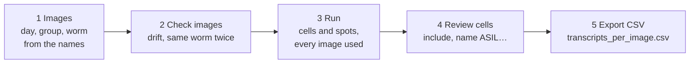

**Names with mistakes.** Case, spaces and hyphens do not matter (`Ins-6Rescue` is
`ins-6rescue`). A misspelt group (up to 2 letters wrong, missing, extra or swapped,
for names of 4 letters or more: `ins-6resuce`) is read as the nearest group and
listed as a warning; a name close to no group, or equally close to two, is left
out until you choose its group in the image table. Give the groups' names in step
1 to match against them; otherwise they are learnt from the file names (the
common spellings).

**The same worm saved twice.** A worm sometimes gets two numbers on one day. Every
image's DAPI projection, filtered to its pattern of nuclei, is compared with the
other images of that day, after aligning the two: the same worm scores 0.93–1.00
(checked on the repeats of the bleaching worms, including one moved 10 µm), two
different worms about 0. Above **0.90** the images are the same worm: only the
first (lowest number) is used, the others are listed with a warning; between 0.75
and 0.90 both are kept and flagged for you to check. The same number used twice in
a group on one day is flagged as well. A worm found under two different groups is
left out (both images) until you decide.

**Drift across the stack.** If the worm was not held still, or the optical table
was bumped, the slices of the stack are shifted sideways against each other. Each
slice is matched to the one below it (phase correlation on the DAPI channel,
filtered to nuclei-sized detail); the shifts add up to each slice's offset.

| Drift through the stack | What happens |
|---|---|
| below 1.5 µm, no jump above 0.5 µm between two slices | nothing (as in the bleaching stacks: 0.75–1.1 µm, the same in every repeat -- the head's own slight tilt, not drift) |
| above 1.5 µm, or a jump above 0.5 µm | **registered**: every slice moved back into line, all channels alike, before anything else |
| above 3 µm | **left out** of the analysis, with a warning |

Checked by moving the slices of real stacks by a known amount: 92–97 % of a
gradual 1.8 µm drift and of a 2 µm jump is measured, and a registered stack is in
line to 0.03 µm. The limits are settings (step 2).

**Your choices win.** In the image table you can change any image's group, or
tick/untick *Use* to include or leave out an image whatever the checks said; in
*Review cells*, include or exclude cells and name the neurons, per image. All of
it is saved in `<out>/groups_state.json` and restored when you open the folder
again; images already run with the same settings are not run again.

**The selection rule in a mutant.** By default cells without ins-6 signal are left
out (section 5). In a group that lacks ins-6 (an ins-6 mutant) that would leave out
every cell: a warning says so when the rule leaves out far more cells in one group
than in the others. Choose another channel under *Exclude cells without* (step 3) or
include the cells by hand.

**Outputs** (in the output folder):

| File | Content |
|---|---|
| `transcripts_per_image.csv` | **The result.** One row per image used: `image` (its id: day folder and file name), `date`, `day`, `group`, `worm`, `file`, `drift_um`, `drift_decision`, `n_cells` (cells of interest), and per channel `<ch>_dots` (spot peaks) and `<ch>_transcripts` (Big-FISH estimate), summed over the cells of interest. Then per neuron, `ASIL_ins6_dots`, `ASIL_ins6_transcripts`, … for ASIL, ASIR, ASJL, ASJR (empty until named). An image without a cell of interest has `n_cells` 0 and empty counts. |
| `cells.csv` | One row per cell of every image used: its identity, whether it counts (`included`, the rule, your choice) and every measurement of section 7. |
| `images_qc.csv` | Every image found: day, group as written and as read, worm, drift, duplicate, `analysed`, and the reason when not. |
| `warnings.json`, `settings.json` | The warnings; every setting and choice the CSVs were made with. |
| `images/<image>/` | Each image's cells, spots and drift (for the review). |

The CSV is rewritten after the run and after every change in the review, so it
always matches what the app shows.

---

## Glossary

| Term | Meaning |
|---|---|
| **a.u.** | Arbitrary units: the camera's brightness numbers (0–255 here). Comparable within this dataset, not across instruments. |
| **AICc** | Akaike information criterion (small-sample corrected): a score of how well a model fits, penalised for its number of parameters. Lower is better. |
| **Background shell** | A thin layer around a cell (0.5–2 µm out) whose median brightness is the cell's local background. |
| **Difference of Gaussians (DoG)** | Narrow blur minus broad blur: keeps structures of one size (here: spots) and removes both finer noise and broader background. |
| **Elbow threshold** | The automatic cut between "many weak peaks" (noise) and "few strong peaks" (spots) on the count-versus-threshold curve. |
| **Gamma** | A curve applied to the displayed brightness between min and max: above 1 lifts faint signal, below 1 darkens it; display only, the measurements never use it. |
| **Gaussian blur** | Replacing each voxel by a weighted average of its neighbours, with weights falling off as a bell curve; its width (sigma) sets how much is blurred. |
| **MAD** | Median absolute deviation: a measure of spread (noise) that, unlike the standard deviation, is not inflated by a few very bright values. |
| **Mask** | A yes/no image: each voxel is either "cell" or "background". |
| **Maximum-intensity projection (MIP)** | For every pixel, the brightest value along the line of sight through the stack (the MIP tab: along z; the additive 3D rendering: along the current viewing direction). |
| **Opening** | Shrinking a mask's shapes then growing them back: removes anything thinner than the shrink distance. |
| **Otsu's method** | Automatic choice of the brightness cut that best separates two groups of voxels. |
| **Phase correlation** | A way to find how far one image is shifted against another, to a fraction of a pixel, from the two images' frequency content. |
| **Registration** | Moving images (here: the slices of a stack) so that the same structures line up. |
| **Reference region / ROI** | The two boxes around the cells of interest (section 5). |
| **Segmentation** | Deciding which voxels belong to which cell. |
| **Volume rendering** | Drawing a 3D image directly as a semi-transparent cloud of coloured voxels (the 3D tab), rather than as surfaces. |
| **Voxel** | A 3D pixel (0.099 × 0.099 × 0.5 µm here). |
| **Watershed** | Splitting an object by growing regions from seed points until they meet (section 4). |
| **z-stack** | A 3D image made of optical sections taken at increasing depths. |
